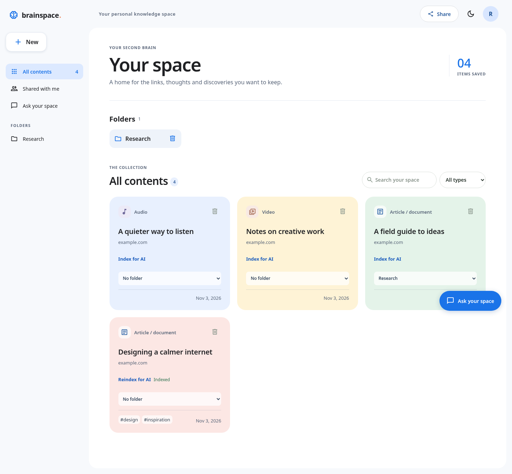
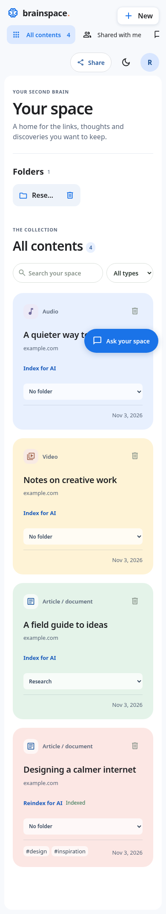

# BrainSpace

A quiet place for the links and ideas you want to keep. BrainSpace brings articles, documents, videos, audio and images together in a personal, searchable collection—and lets you share a read-only view when you choose.



<details><summary>Mobile view</summary>



</details>

Screenshots use sample data and a test-only AI provider stub from the automated browser test.

## Features

- Create an account and sign in with a username and password.
- Save HTTP(S) links with a title, type and optional tags; browse, search and filter them.
- Organize links into single-level folders, and move items between folders. Empty folders can be deleted.
- Keep read-only BrainSpace links shared with you by pasting them into **Shared with me**; a revoked or rotated link stops working.
- Toggle light/dark mode and access your account menu in the top-right.
- Remove saved items. Each account can access only its own collection.
- Create a revocable, read-only link to your entire collection. Anyone possessing the link can view it; creating a new one invalidates the old one.
- Ask questions over explicitly indexed sources, with quotations, links and a conservative evidence check.
- Responsive interface, keyboard-accessible dialogs, loading, empty and error states.

The standard search filters saved titles, URLs and tags locally. Optional AI search uses indexed source text and embeddings; it is disabled until configured. AI answers may still be wrong: check their quoted evidence. Editing saved items, nested folders, file uploads, password recovery and automatic shared-link discovery are not currently implemented.

## Stack and architecture

React 18, TypeScript, Vite and Recoil in `frontend/`; TypeScript, Express, Mongoose and MongoDB in `src/`; and Python for the RAG pipeline in `rag/`. A same-origin reverse proxy serves the frontend and routes `/api` to the API. Authentication uses bcrypt and a signed, HTTP-only cookie. MongoDB holds users, content, tags and hashed sharing tokens. See [DEVELOPMENT.md](DEVELOPMENT.md).

## Local setup

Prerequisites: Node.js 22.12+ and npm, Python 3.10+ for AI search and its tests, and a running MongoDB instance. The Python pipeline uses only the standard library. From the repository root:

```bash
npm ci
npm --prefix frontend ci
cp .env.example .env
```

Set `MONGODB_URI` to your MongoDB URI and replace `ACCESS_TOKEN_SECRET` in `.env` with at least 32 random characters. Leave `CORS_ORIGIN=http://localhost:5173` for the default Vite development server. Do not commit `.env`.

```bash
# Terminal 1: API on http://localhost:8000
npm run dev
# Terminal 2: frontend on http://localhost:5173 (proxies /api to the API)
npm --prefix frontend run dev
```

Visit `http://localhost:5173` and create an account. Set `PORT`, `CORS_ORIGIN`, or the optional `TRUST_PROXY_HOPS` on the backend as needed; the default Vite dev proxy expects port 8000. For other deployments, the frontend's optional build-time `VITE_API_URL` defaults to `/api`.

## Optional AI search

Set `RAG_ENABLED=true` and a server-side `GEMINI_API_KEY` in `.env`. The default embedding and chat models can be configured via `GEMINI_EMBEDDING_MODEL` and `GEMINI_CHAT_MODEL`; see [RAG_EVALUATION.md](RAG_EVALUATION.md). Restart the API, save a link, choose **Index for AI**, and explicitly consent before indexing. Leave the text field blank to fetch an accessible public HTML/text page, or paste text/transcripts. Open **Ask your space** to use the full workspace assistant and its source sidebar. Reindex any sources indexed with the earlier OpenAI model. Indexing and questions send text to Gemini and may incur charges. The feature will not work without a valid key and network access; it is off by default.

## Build and test

```bash
npm run build && npm test && npm run test:rag
npm --prefix frontend run build && npm --prefix frontend test
npx playwright install chromium  # one-time, if Chromium is not already available
npm run test:e2e
```

MongoDB integration tests use an isolated temporary database and may download a MongoDB binary on first use. See [TESTING.md](TESTING.md) for prerequisites, browser configuration, and coverage limitations. For production configuration, security, migrations and rollback, see [DEPLOYMENT.md](DEPLOYMENT.md).
